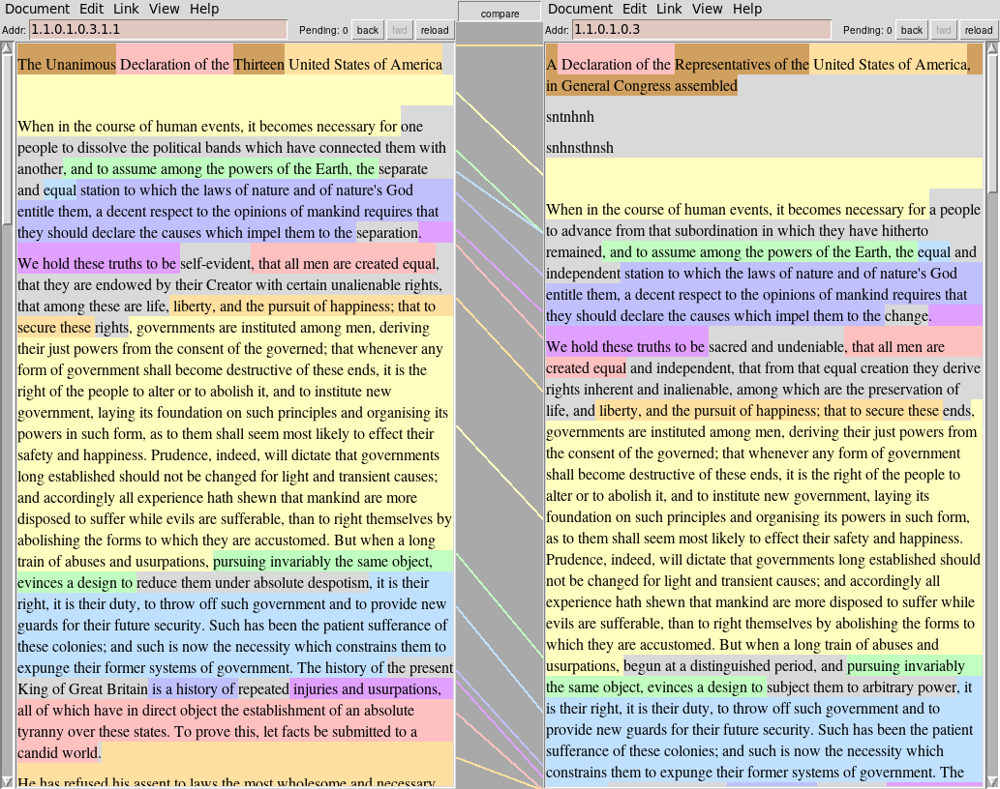

# Udanax Green

[Udanax Green](https://udanax.xanadu.com/green/) is the open-source release of the **Xanadu 88.1** hypertext system. Its C backend stores interconnected documents in *enfilades*, supporting persistent addresses, links between document spans, shared content (*transclusion*), and document versions. **Pyxi** is the accompanying graphical browser/editor, originally written by Ka-Ping Yee in Python and Tk.

This repository preserves the historical source release and adds **modern Linux/NixOS build support**, a Python 3 port of Pyxi, compatibility fixes, and automated tests. The original top-level README is preserved verbatim as [README.orig](README.orig) (1999); see also the [original Pyxi README](pyxi/README) and [detailed porting notes](NIXOS.md).



*Pyxi's **Parallel View / Compare** displays two Declaration of Independence documents from the sample database. Colored passages and connecting lines identify corresponding spans of shared Xanadu content, rather than just matching text. Screenshot from the modernized Python 3/Tk frontend.*

## Quick start on NixOS (or Linux with Nix)

```sh
nix run .#pyxi          # graphical browser/editor (also the default: nix run)
nix run .#pyxi-clean    # separate sample database, without changing your regular state
```

The Pyxi launcher prepares a **writable** copy of the included sample database at
`~/.local/state/udanax-green/be/enf.enf` (or under `$XDG_STATE_HOME` if set).
Edits persist across launches; back up this file if you want to keep your changes.
The original sample in the Nix store is not modified.

Other included apps:

| Command | Purpose |
| --- | --- |
| `nix run .#xumain` | Standalone interactive backend protocol console; uses `./enf.enf` |
| `nix run .#backend` | Pipe-protocol backend for a frontend to control |
| `nix run .#backenddaemon` | Historical network backend daemon (advanced use) |

## Build and test

The flake builds the original C backend executables and packages the ported Pyxi frontend:

```sh
nix build             # compile the C backend
nix build .#pyxi      # package Pyxi (Python 3 / Tk)
nix flake check       # backend, persistence, protocol and Tk GUI regression tests
nix develop           # C compiler, build tools, Python/Tk development environment
```

To compile the backend directly from the development shell, without building a Nix derivation:

```sh
nix develop
make -C green/be_source CC=cc CFLAGS="$UDANAX_CFLAGS" LFLAGS= all
```

This produces `green/be_source/xumain`, `backend`, and `backenddaemon`. The backend works with a writable `enf.enf` file in its working directory; **do not run it against the sample file in the Nix store**. The GUI is most easily launched through `nix run .#pyxi`, which prepares a writable database and starts the backend.

## What changed from the historical release?

- **Nix flake:** reproducible package, named apps, development shell, and build/test checks.
- **Modern compiler support:** compatibility repairs for legacy C declarations, 64-bit pointers, libc calls, sockets, format strings, configuration parsing, and free-disk allocation.
- **Pyxi on Python 3/Tk:** ported the original GUI and protocol client, with a persistent-state launcher and fixes for keyboard editing, clipboard paste, selection, linking, and transclusion.
- **UI improvements:** larger document fonts, a View menu, formatted help, clickable links in read-only mode, a linked-document browser, and a usable Parallel View / Compare layout.
- **Regression tests:** backend startup, text/link persistence across restarts, protocol interactions, and actual Tk GUI operations under Xvfb.

Much of this is **compatibility and usability work**, not a redesign of the Xanadu data model. The backend still has known limitations: version creation can abort in some cases, link creation in newly initialized databases is problematic, and the original sample database may be rewritten on open/close. Tests cover selected operations, not full database integrity or cross-platform compatibility. Details and reproduction notes are in [NIXOS.md](NIXOS.md).

The repository also retains a separate `historical/roger-gregory-2007` branch containing an independently modified source tree. Selected fixes are incorporated in `master`; the historical import remains available for comparison.

## Using Pyxi

The sample database opens at document address `1.1.0.1.0.1`. You can navigate by entering another Xanadu *tumbler* address, following colored link endpoints, or selecting **Document → Browse Linked Documents**. **View → Parallel View / Compare** (`Alt+P`) opens two document panes to show related content. In the **Edit** menu, enable editing before typing, and use **Mark** then **Transclude** to share a selected passage with another document.

See **Help → Controls and Shortcuts** inside Pyxi for more controls. The linked-document browser explores reachable documents; it is not an exhaustive index of the entire database.

## Original distribution and license

The original Udanax Green release dates to **2 September 1999**. Its introduction, build notes, and full permission notice remain in [README.orig](README.orig); the project's historical [license](license.html) is also included. See the [Udanax Green archive](https://udanax.xanadu.com/green/) for background and documentation.
